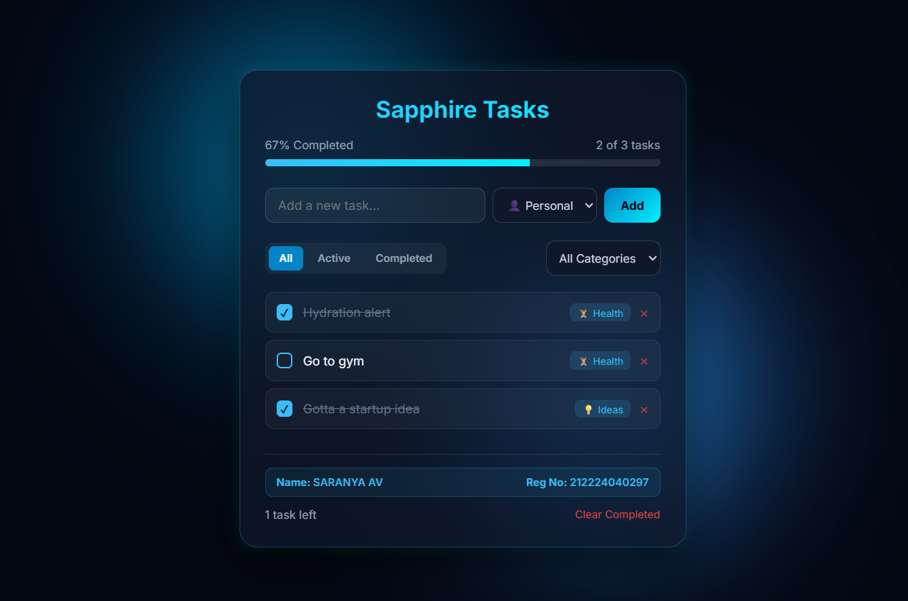
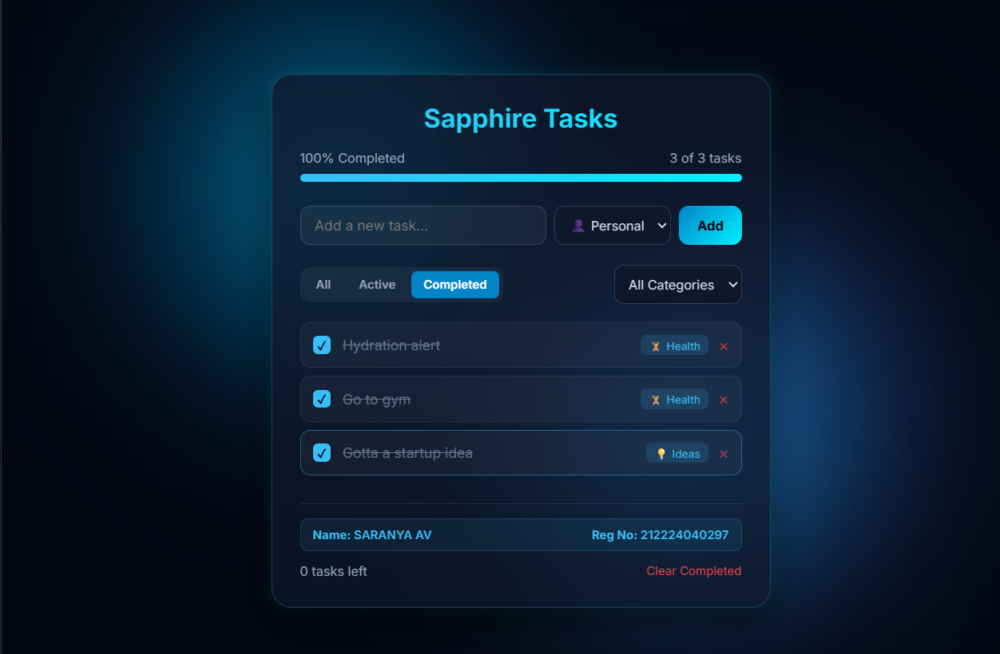

# Ex03 To-Do List using JavaScript
## Date:

## AIM
To create a To-do Application with all features using JavaScript.

## ALGORITHM
### STEP 1
Build the HTML structure (index.html).

### STEP 2
Style the App (style.css).

### STEP 3
Plan the features the To-Do App should have.

### STEP 4
Create a To-do application using Javascript.

### STEP 5
Add functionalities.

### STEP 6
Test the App.

### STEP 7
Open the HTML file in a browser to check layout and functionality.

### STEP 8
Fix styling issues and refine content placement.

### STEP 9
Deploy the website.

### STEP 10
Upload to GitHub Pages for free hosting.

## PROGRAM
index.html
```
<!DOCTYPE html>
<html lang="en">
<head>
  <meta charset="UTF-8">
  <meta name="viewport" content="width=device-width, initial-scale=1.0">
  <title>Blue Sapphire To-Do List</title>
  <link rel="stylesheet" href="style.css">
  <link href="https://fonts.googleapis.com/css2?family=Inter:wght@300;400;500;600;700&display=swap" rel="stylesheet">
</head>
<body>
  <!-- Ambient Animated Background Blobs -->
  <div class="ambient-blob blob-1"></div>
  <div class="ambient-blob blob-2"></div>
  <div class="ambient-blob blob-3"></div>

  <!-- Glassmorphism Main Card -->
  <div class="glass-container">
    <header class="app-header">
      <h2>Sapphire Tasks</h2>
      <div class="progress-box">
        <div class="progress-info">
          <span id="progressText">0% Completed</span>
          <span id="taskStats">0 of 0 tasks</span>
        </div>
        <div class="progress-bar-bg">
          <div class="progress-bar-fill" id="progressFill"></div>
        </div>
      </div>
    </header>

    <div class="input-card">
      <div class="input-row">
        <input type="text" id="taskInput" placeholder="Add a new task..." maxlength="80">
        <select id="categorySelect">
          <option value="Work">💼 Work</option>
          <option value="Personal">👤 Personal</option>
          <option value="Ideas">💡 Ideas</option>
          <option value="Health">🏋️ Health</option>
        </select>
        <button id="addBtn">Add</button>
      </div>
    </div>

    <div class="controls-row">
      <div class="filter-tabs">
        <button class="tab active" data-filter="all">All</button>
        <button class="tab" data-filter="active">Active</button>
        <button class="tab" data-filter="completed">Completed</button>
      </div>
      <select id="categoryFilter">
        <option value="all">All Categories</option>
        <option value="Work">💼 Work</option>
        <option value="Personal">👤 Personal</option>
        <option value="Ideas">💡 Ideas</option>
        <option value="Health">🏋️ Health</option>
      </select>
    </div>

    <ul id="taskList" class="task-list"></ul>

    <footer class="app-footer">
      <div class="footer-student-info">
        <span><strong>Name:</strong> SARANYA AV</span>
        <span><strong>Reg No:</strong> 212224040297</span>
      </div>
      <div class="footer-actions">
        <span id="remainingCount">0 tasks left</span>
        <button id="clearCompletedBtn">Clear Completed</button>
      </div>
    </footer>
  </div>

  <script src="script.js"></script>
</body>
</html>
```
style.css

```
* {
  box-sizing: border-box;
  margin: 0;
  padding: 0;
  font-family: 'Inter', sans-serif;
}

body {
  background-color: #030712;
  color: #f1f5f9;
  min-height: 100vh;
  display: flex;
  justify-content: center;
  align-items: center;
  padding: 20px;
  overflow-x: hidden;
  position: relative;
}

/* Ambient Animated Blue Blobs */
.ambient-blob {
  position: absolute;
  border-radius: 50%;
  filter: blur(80px);
  opacity: 0.5;
  z-index: 0;
  animation: floatBlob 10s infinite alternate ease-in-out;
}

.blob-1 {
  width: 320px;
  height: 320px;
  background: radial-gradient(circle, #00f0ff, #0072ff);
  top: 10%;
  left: 15%;
}

.blob-2 {
  width: 380px;
  height: 380px;
  background: radial-gradient(circle, #3a86ff, #030712);
  bottom: 10%;
  right: 15%;
  animation-delay: -5s;
}

.blob-3 {
  width: 250px;
  height: 250px;
  background: radial-gradient(circle, #00d2ff, #3a86ff);
  top: 50%;
  left: 50%;
  transform: translate(-50%, -50%);
}

@keyframes floatBlob {
  0% { transform: translate(0, 0) scale(1); }
  100% { transform: translate(30px, -40px) scale(1.1); }
}

/* Glassmorphism Container */
.glass-container {
  position: relative;
  z-index: 1;
  width: 100%;
  max-width: 500px;
  background: rgba(15, 23, 42, 0.75);
  backdrop-filter: blur(16px);
  -webkit-backdrop-filter: blur(16px);
  border: 1px solid rgba(56, 189, 248, 0.25);
  border-radius: 20px;
  padding: 28px;
  box-shadow: 0 15px 35px rgba(0, 0, 0, 0.6), 0 0 15px rgba(0, 240, 255, 0.15);
}

.app-header {
  margin-bottom: 24px;
}

.app-header h2 {
  font-size: 26px;
  font-weight: 700;
  background: linear-gradient(135deg, #38bdf8, #00f0ff);
  -webkit-background-clip: text;
  -webkit-text-fill-color: transparent;
  margin-bottom: 16px;
  text-align: center;
}

.progress-info {
  display: flex;
  justify-content: space-between;
  font-size: 13px;
  color: #94a3b8;
  margin-bottom: 8px;
}

.progress-bar-bg {
  height: 8px;
  background: rgba(255, 255, 255, 0.1);
  border-radius: 4px;
  overflow: hidden;
}

.progress-bar-fill {
  height: 100%;
  width: 0%;
  background: linear-gradient(90deg, #38bdf8, #00f0ff);
  transition: width 0.4s ease;
}

.input-card {
  margin-bottom: 20px;
}

.input-row {
  display: flex;
  gap: 8px;
}

#taskInput {
  flex: 1;
  background: rgba(255, 255, 255, 0.05);
  border: 1px solid rgba(255, 255, 255, 0.15);
  border-radius: 10px;
  padding: 10px 14px;
  color: #fff;
  font-size: 14px;
  outline: none;
  transition: 0.2s;
}

#taskInput:focus {
  border-color: #38bdf8;
  box-shadow: 0 0 10px rgba(56, 189, 248, 0.3);
}

#categorySelect, #categoryFilter {
  background: rgba(15, 23, 42, 0.9);
  border: 1px solid rgba(255, 255, 255, 0.15);
  border-radius: 10px;
  color: #cbd5e1;
  padding: 10px;
  font-size: 13px;
  outline: none;
}

#addBtn {
  background: linear-gradient(135deg, #0284c7, #00f0ff);
  color: #030712;
  border: none;
  font-weight: 700;
  padding: 0 18px;
  border-radius: 10px;
  cursor: pointer;
  transition: 0.2s;
}

#addBtn:hover {
  opacity: 0.9;
  transform: translateY(-1px);
}

.controls-row {
  display: flex;
  justify-content: space-between;
  align-items: center;
  margin-bottom: 18px;
  gap: 10px;
}

.filter-tabs {
  display: flex;
  gap: 4px;
  background: rgba(255, 255, 255, 0.05);
  padding: 4px;
  border-radius: 10px;
}

.tab {
  background: none;
  border: none;
  color: #94a3b8;
  padding: 6px 12px;
  font-size: 12px;
  font-weight: 600;
  border-radius: 6px;
  cursor: pointer;
}

.tab.active {
  background: #0284c7;
  color: #fff;
}

.task-list {
  list-style: none;
  max-height: 280px;
  overflow-y: auto;
  margin-bottom: 20px;
}

.task-item {
  display: flex;
  align-items: center;
  justify-content: space-between;
  background: rgba(255, 255, 255, 0.04);
  border: 1px solid rgba(255, 255, 255, 0.08);
  padding: 12px;
  border-radius: 10px;
  margin-bottom: 8px;
  transition: 0.2s;
}

.task-item:hover {
  border-color: rgba(56, 189, 248, 0.4);
}

.task-left {
  display: flex;
  align-items: center;
  gap: 12px;
  flex: 1;
}

.custom-checkbox {
  width: 18px;
  height: 18px;
  border: 2px solid #38bdf8;
  border-radius: 5px;
  cursor: pointer;
  display: flex;
  align-items: center;
  justify-content: center;
}

.task-item.completed .custom-checkbox {
  background: #38bdf8;
}

.task-item.completed .custom-checkbox::after {
  content: '✓';
  color: #030712;
  font-size: 12px;
  font-weight: 900;
}

.task-text {
  font-size: 14px;
  color: #f1f5f9;
  flex: 1;
  cursor: pointer;
}

.task-item.completed .task-text {
  text-decoration: line-through;
  color: #64748b;
}

.badge {
  font-size: 11px;
  background: rgba(56, 189, 248, 0.15);
  color: #38bdf8;
  padding: 3px 8px;
  border-radius: 6px;
}

.delete-btn {
  background: none;
  border: none;
  color: #ef4444;
  cursor: pointer;
  font-size: 16px;
  margin-left: 10px;
  opacity: 0.7;
}

.delete-btn:hover {
  opacity: 1;
}

/* Footer Section */
.app-footer {
  display: flex;
  flex-direction: column;
  gap: 12px;
  font-size: 13px;
  color: #94a3b8;
  padding-top: 14px;
  border-top: 1px solid rgba(255, 255, 255, 0.1);
}

.footer-student-info {
  display: flex;
  justify-content: space-between;
  color: #38bdf8;
  font-weight: 600;
  font-size: 12px;
  background: rgba(56, 189, 248, 0.08);
  padding: 8px 12px;
  border-radius: 8px;
  border: 1px solid rgba(56, 189, 248, 0.2);
}

.footer-actions {
  display: flex;
  justify-content: space-between;
  align-items: center;
}

#clearCompletedBtn {
  background: none;
  border: none;
  color: #ef4444;
  cursor: pointer;
  font-size: 12px;
}

#clearCompletedBtn:hover {
  text-decoration: underline;
}
```
script.js
```
document.addEventListener('DOMContentLoaded', () => {
  const taskInput = document.getElementById('taskInput');
  const categorySelect = document.getElementById('categorySelect');
  const addBtn = document.getElementById('addBtn');
  const taskList = document.getElementById('taskList');
  const categoryFilter = document.getElementById('categoryFilter');
  const tabs = document.querySelectorAll('.tab');
  const remainingCount = document.getElementById('remainingCount');
  const clearCompletedBtn = document.getElementById('clearCompletedBtn');
  const progressText = document.getElementById('progressText');
  const taskStats = document.getElementById('taskStats');
  const progressFill = document.getElementById('progressFill');

  let tasks = JSON.parse(localStorage.getItem('sapphire_todos')) || [];
  let currentStatusFilter = 'all';
  let currentCategoryFilter = 'all';

  function saveAndRender() {
    localStorage.setItem('sapphire_todos', JSON.stringify(tasks));
    renderTasks();
  }

  function renderTasks() {
    taskList.innerHTML = '';

    const filtered = tasks.filter(task => {
      const statusMatch = currentStatusFilter === 'all' ? true :
                         currentStatusFilter === 'active' ? !task.completed : task.completed;
      const categoryMatch = currentCategoryFilter === 'all' ? true : task.category === currentCategoryFilter;
      return statusMatch && categoryMatch;
    });

    if (filtered.length === 0) {
      taskList.innerHTML = `<li style="text-align:center; color:#64748b; padding:20px; font-size:13px;">No tasks found</li>`;
    } else {
      filtered.forEach(task => {
        const li = document.createElement('li');
        li.className = `task-item ${task.completed ? 'completed' : ''}`;

        li.innerHTML = `
          <div class="task-left">
            <div class="custom-checkbox"></div>
            <span class="task-text">${task.text}</span>
            <span class="badge">${getCategoryIcon(task.category)} ${task.category}</span>
          </div>
          <button class="delete-btn">&times;</button>
        `;

        li.querySelector('.task-left').addEventListener('click', () => toggleTask(task.id));

        const textSpan = li.querySelector('.task-text');
        textSpan.addEventListener('dblclick', (e) => {
          e.stopPropagation();
          enableInlineEdit(task.id, textSpan);
        });

        li.querySelector('.delete-btn').addEventListener('click', (e) => {
          e.stopPropagation();
          deleteTask(task.id);
        });

        taskList.appendChild(li);
      });
    }

    updateMetrics();
  }

  function getCategoryIcon(cat) {
    const icons = { Work: '💼', Personal: '👤', Ideas: '💡', Health: '🏋️' };
    return icons[cat] || '📋';
  }

  function addTask() {
    const text = taskInput.value.trim();
    if (!text) return;

    const newTask = {
      id: Date.now(),
      text: text,
      category: categorySelect.value,
      completed: false
    };

    tasks.push(newTask);
    taskInput.value = '';
    saveAndRender();
  }

  function toggleTask(id) {
    tasks = tasks.map(t => t.id === id ? { ...t, completed: !t.completed } : t);
    saveAndRender();
  }

  function deleteTask(id) {
    tasks = tasks.filter(t => t.id !== id);
    saveAndRender();
  }

  function enableInlineEdit(id, element) {
    const currentText = element.textContent;
    const input = document.createElement('input');
    input.type = 'text';
    input.value = currentText;
    input.style.cssText = 'background:rgba(255,255,255,0.1); border:1px solid #38bdf8; color:#fff; border-radius:4px; padding:2px 6px; width:100%; font-size:14px; outline:none;';

    element.replaceWith(input);
    input.focus();

    const saveEdit = () => {
      const updatedText = input.value.trim();
      if (updatedText) {
        tasks = tasks.map(t => t.id === id ? { ...t, text: updatedText } : t);
        saveAndRender();
      } else {
        renderTasks();
      }
    };

    input.addEventListener('blur', saveEdit);
    input.addEventListener('keypress', (e) => {
      if (e.key === 'Enter') saveEdit();
    });
  }

  function updateMetrics() {
    const total = tasks.length;
    const completed = tasks.filter(t => t.completed).length;
    const active = total - completed;
    const percentage = total === 0 ? 0 : Math.round((completed / total) * 100);

    progressFill.style.width = `${percentage}%`;
    progressText.textContent = `${percentage}% Completed`;
    taskStats.textContent = `${completed} of ${total} tasks`;
    remainingCount.textContent = `${active} task${active !== 1 ? 's' : ''} left`;
  }

  addBtn.addEventListener('click', addTask);
  taskInput.addEventListener('keypress', (e) => {
    if (e.key === 'Enter') addTask();
  });

  tabs.forEach(tab => {
    tab.addEventListener('click', () => {
      tabs.forEach(t => t.classList.remove('active'));
      tab.classList.add('active');
      currentStatusFilter = tab.dataset.filter;
      renderTasks();
    });
  });

  categoryFilter.addEventListener('change', (e) => {
    currentCategoryFilter = e.target.value;
    renderTasks();
  });

  clearCompletedBtn.addEventListener('click', () => {
    tasks = tasks.filter(t => !t.completed);
    saveAndRender();
  });

  renderTasks();
});

```

## OUTPUT



## RESULT
The program for creating To-do list using JavaScript is executed successfully.
